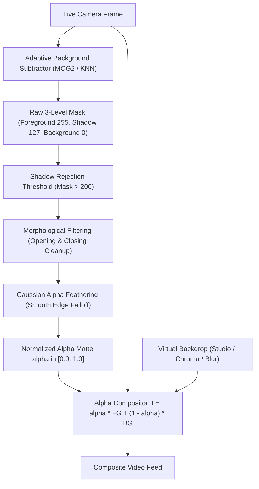

# Module 11: Foreground Segmentation & Virtual Backgrounds

## Overview

Image segmentation partitions an image into meaningful visual components by assigning a classification label to every individual pixel. In interactive video conferencing (Zoom, Google Meet, Microsoft Teams), virtual background replacement isolates the foreground speaker from physical room clutter without requiring physical green-screen drapery.

This module builds a real-time, self-contained foreground segmentation and virtual compositing pipeline. It explores statistical background subtraction models (Mixture of Gaussians MOG2 and K-Nearest Neighbors KNN), photometric shadow suppression, morphological matte refinement, alpha feathering, and real-time multi-buffer blending across virtual studio, chroma, and portrait blur backdrops.

---

## Key Engineering Concepts

### Background Subtraction Models (MOG2 vs. KNN)

Unlike static frame differencing which fails under gradual lighting shifts or camera noise, statistical background subtractors model each pixel as a temporal probability distribution:
- **MOG2 (Gaussian Mixture Model):** Models the color distribution of each pixel over time as a mixture of $K$ adaptive Gaussians ($K \in [3, 5]$). Adapts smoothly to fluctuating illumination, swaying curtains, and flickering monitors.
- **KNN (K-Nearest Neighbors):** Maintains a circular buffer of past pixel samples and classifies incoming pixels as foreground if fewer than $K$ samples reside within a Euclidean distance threshold. Excels in scenes with rapid motion and dynamic textures.

### Photometric Shadow Suppression

A common point of failure in background segmentation is cast shadows:
- When a person moves, their shadow dims floor and wall pixels without changing their chromatic hue.
- Naive binary thresholding misclassifies shadows as foreground, creating distorted, bloated silhouettes.
- Both MOG2 and KNN detect shadows by analyzing color angle and luminance attenuation. Shadows are tagged with gray values ($\sim 127$), allowing downstream thresholding ($> 200$) to reject shadows cleanly while preserving true foreground ($255$).

### Matte Refinement & Gaussian Alpha Feathering

Raw subtraction masks suffer from two physical artifacts:
1. **Isolated Sensor Speckles:** Suppressed via Morphological Opening (Erosion followed by Dilation).
2. **Internal Dropout Cavities:** Filled via Morphological Closing (Dilation followed by Erosion).

Binary masks produce harsh, jagged stair-step edges. To achieve natural photographic compositing, the binary mask is softened using Gaussian alpha feathering to generate continuous fractional transparency $\alpha(x, y) \in [0.0, 1.0]$.



### Alpha Compositing Equation

The final frame blends physical camera pixels with the chosen virtual backdrop through point-wise linear interpolation:

$$I_{\text{composite}}(x, y) = \alpha(x, y) \cdot I_{\text{camera}}(x, y) + (1.0 - \alpha(x, y)) \cdot I_{\text{backdrop}}(x, y)$$

---

## Running the Module

Execute via the project Makefile:

```bash
make run phase-03/11-segmentation/main.py
```

### Interactive Controls
- **`m`:** Cycle Segmentation Model (`Neural U2-NetP` <-> `MOG2` <-> `KNN`)
- **`Space`:** Lock clean background plate (calibrates on empty room for classical subtractors)
- **`1`:** Virtual Studio Backdrop (Procedural depth-of-field ambient lighting)
- **`2`:** Chroma Green Screen (Standard solid green replacement for broadcast streaming)
- **`3`:** Portrait Background Blur (Heavy Gaussian bokeh applied to physical room background)
- **`4`:** Refined Alpha Matte (Visualizes foreground alpha transparency in grayscale)
- **`5`:** Split View (Side-by-side comparison of raw camera feed vs virtual replacement)
- **`r`:** Reset background model to continuous adaptive learning
- **`+` / `-`:** Increase / decrease background model learning rate ($\pm 0.005$)
- **`[` / `]`:** Adjust Gaussian alpha edge feathering width ($\pm 0.5\text{px}$)
- **`c`:** Cycle active camera device index (0 <-> 2)
- **`s`:** Save composited snapshot to `output/`
- **`q` or `Esc`:** Quit
